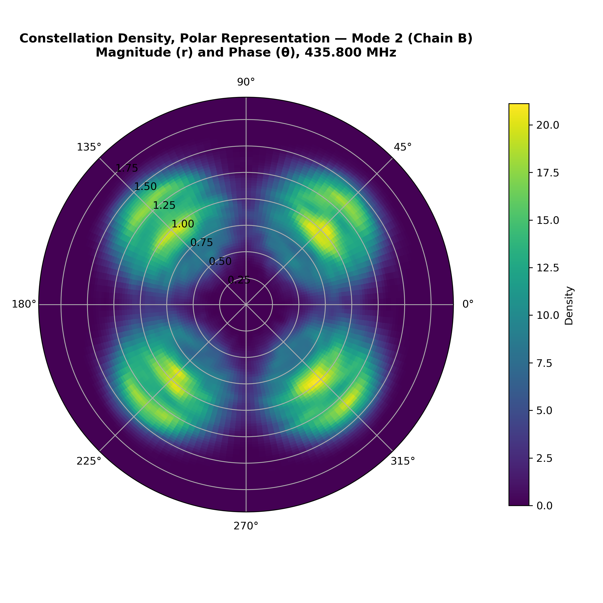
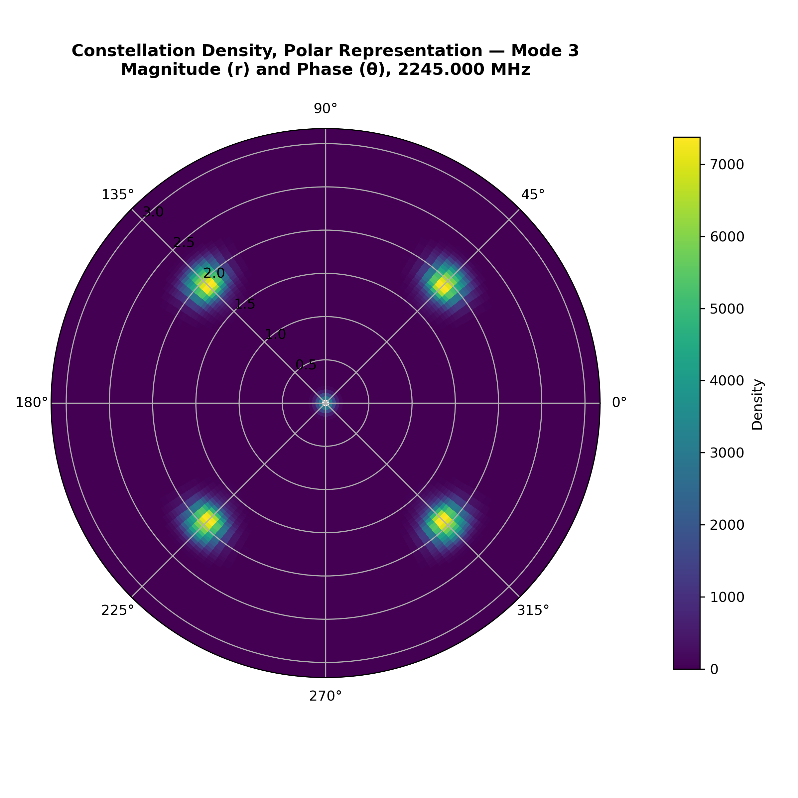

# NSU-AI-SAT communications subsystem

GNU Radio flowgraphs and design documents for the communications and ground station subsystem of NSU-AI-SAT, a 3U CubeSat built at NIRO Lab (NSU Intelligent Robotics Lab), North South University, for the APSCO CubeSat Competition.

The subsystem runs five operating modes from one software-defined radio (a GomSpace NanoCom TR600 with an AD9361 front end). Each mode has a satellite-side flowgraph (STL) and a ground-station flowgraph (GND).

## My part

I was on the communications and ground station team. I co-designed the five-mode frequency plan and built the GNU Radio signal chains for the satellite terminal and the ground station. The link budget, antenna analysis and the rest of the satellite were done by other members of the NSU-AI-SAT team.

## Operating modes (satellite side)

| Mode | Telecommand (BFSK) | Telemetry (GFSK) | Payload data (QPSK) | Beacon (CW/OOK) |
|---|---|---|---|---|
| 1, Default | UHF RX 437.100 MHz | UHF TX 437.325 MHz | none | none |
| 2, General | UHF RX 437.100 MHz | UHF TX 437.325 MHz | UHF TX/RX 436.500 / 435.800 MHz | VHF 145.840 MHz |
| 3, Inter-satellite link | UHF RX 437.100 MHz | UHF TX 437.325 MHz | S-band TX/RX 2245 MHz (TDD) | VHF 145.840 MHz |
| 4, High data downlink | UHF RX 437.100 MHz | UHF TX 437.325 MHz | S-band TX 2245 MHz | VHF 145.840 MHz |
| 5, Emergency | UHF RX 437.100 MHz | VHF TX 145.950 MHz | none | VHF 145.840 MHz |

The ground station mirrors this with transmit and receive swapped. Frequencies sit in the amateur-satellite sub-bands and are design values, not licensed assignments.

Under the team's link budget, the 1 Mbps S-band downlink closes with 16.5 dB of margin at 24° elevation and sends a full 156 Mbit payload observation in one pass. The UHF command and telemetry link at 9600 bps has 19.6 dB of downlink margin at the same elevation.

## What the flowgraphs do

Each data chain uses differential QPSK with automatic gain control, a polyphase clock synchronizer and a Costas loop for carrier recovery, followed by a constellation decoder and differential decoder. Telecommand, telemetry and beacon chains use BFSK, GFSK and CW/OOK. The flowgraphs run in simulation: they check signal paths, modulation, carrier and timing recovery, beacon keying and S-band burst timing. They do not model radiated power, antenna gain, noise figure, Doppler or bit error rate on real hardware.

## Repository layout

```
docs/
  GNU_Radio_Validation_Report.pdf   all five modes: signal chains, figures, flowgraph canvases
  Communication_Modes.pdf           mode tables for satellite and ground station
satellite/mode1 ... mode5           STL flowgraphs (.grc) and generated Python
ground/mode1 ... mode5              GND flowgraphs (.grc) and generated Python
results/satellite, results/ground   constellations, spectra, eye diagrams, waveforms
```

## Sample results

Mode 2, recovered QPSK constellation on the UHF data channel (satellite side):



Mode 3, recovered QPSK constellation on the 2245 MHz inter-satellite link (satellite side):



## Known issues

- Mode 4: the offline signal tap meant for the S-band constellation and eye diagram is connected to the telecommand baseband instead, so those two offline figures are missing. The live GNU Radio constellation still shows correct QPSK recovery.
- Also still open from the design review: the Mode 5 beacon route, a display label that reads 437.325 MHz, and a short prototype access code.

## Running the flowgraphs

Open any `.grc` file in GNU Radio Companion and run it. Recorded signal files were left out of this repository because of their size.
